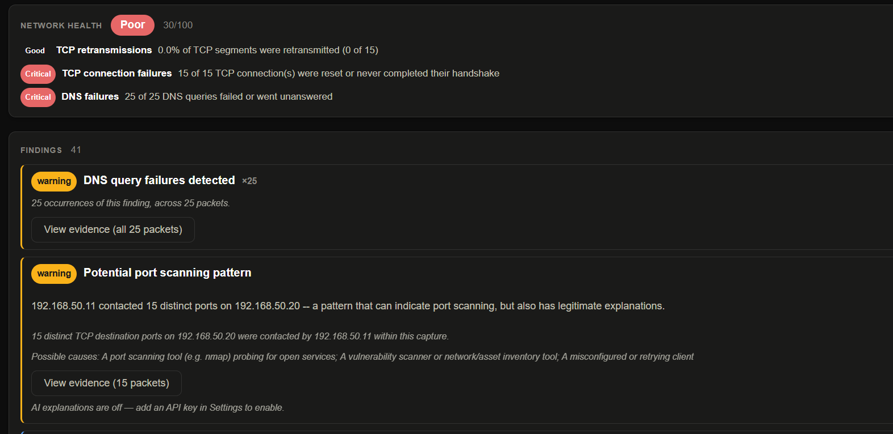

# Tracelucid

**Reads your network traffic like Wireshark. Explains it like a person.**

Tracelucid is a desktop network traffic analyzer for Windows and Linux. Open a capture and it tells you, in plain words, what happened and what went wrong. Every conclusion is linked to the exact packets that prove it, so you can always check it yourself.

**Website:** https://djbrar.github.io/tracelucid-releases/
**Guide:** https://djbrar.github.io/tracelucid-releases/guide.html
**Download:** [latest release](https://github.com/djbrar/tracelucid-releases/releases/latest)



## What it does

- **What happened, in plain words.** A short story at the top of every capture: what it contains and which problems started when, each linked to its evidence.
- **A health score you can check.** A weighted score out of 100, with every factor that went into it shown next to it. Never a black-box number.
- **Findings with evidence.** Each finding names the hosts involved, lists possible causes (including the harmless ones) and recommended actions, and highlights the exact packets behind it. Among them:
  - failed TCP handshakes, retransmissions, resets, refused connections, a receiver that stopped reading (zero window)
  - DNS failures, slow DNS and slow servers
  - TLS handshakes that failed, HTTP 4xx/5xx errors, ICMP errors explained (which router or firewall sent them, about which traffic)
  - DHCP with no server answering, IP address conflicts, possible ARP spoofing
  - fragmentation and path-MTU problems, asymmetric routing
  - poor VoIP/video call quality, per direction
  - logins sent unencrypted (the password is never repeated in the finding)
  - security signals: port scans, beacon-like timing, large outbound transfers, suspicious DNS names
- **"Why can't A reach B?"** Type two addresses or names and get the most telling answer: blocked by a firewall, refused, no answer, TLS failed, an HTTP error, slow, or reached.
- **Follow traffic through a firewall.** Open the captures a firewall took at different points (Palo Alto, Check Point, Cisco ASA/FTD, FortiGate, Juniper SRX, Sophos, or any device) and Tracelucid recognises them. It then shows what happened to each connection: forwarded, translated by NAT, dropped, or never answered.
- **A packet detail pane that explains.** What the packet does in plain words, Wireshark's full decoded tree with links to related packets, and the raw bytes with the selected field highlighted.
- **Where the time went.** For a slow connection: DNS, connect, TLS, waiting for the server, download, with a one-line verdict.
- **More views:** traffic over time, a network map of who talks to whom, names next to IP addresses (taken from the capture), call quality, Follow Stream (a whole conversation as readable text), and search in plain words ("failed dns", "resets to shop.example").
- **Open, capture, compare, save.** Open one or several PCAP/PCAPNG files (merged into one timeline), filter on import for large files, capture live from a network interface, compare a "before" and "after" capture, and save investigations with notes.
- **PDF reports**, with the sections you choose.

## Privacy

Nothing leaves your machine unless you turn it on. AI explanations and IP-reputation lookups are optional and off by default. They use your own API key (kept in your system's credential store), and only the item you ask about is sent.

## Install

Tracelucid uses Wireshark's own tools (`tshark`, `dumpcap`) to read packets, so **Wireshark must be installed first**: [wireshark.org/download](https://www.wireshark.org/download.html).

Download the installer for your system from the [latest release](https://github.com/djbrar/tracelucid-releases/releases/latest).

### Windows

1. Install Wireshark. Keep **Npcap** selected in its installer if you want live capture.
2. Run `Tracelucid_<version>_x64-setup.exe` (or the `.msi`).
3. The installers aren't code-signed yet, so Windows SmartScreen may say "Windows protected your PC". Click **More info**, then **Run anyway**.

### Linux

Install `tshark` with your package manager, then one of:

```bash
sudo dpkg -i Tracelucid_<version>_amd64.deb        # Debian, Ubuntu, Kali
sudo rpm -i Tracelucid-<version>-1.x86_64.rpm      # Fedora, RHEL, openSUSE
chmod +x Tracelucid_<version>_amd64.AppImage && ./Tracelucid_<version>_amd64.AppImage
```

For live capture, add yourself to the `wireshark` group, then log out and back in:

```bash
sudo usermod -aG wireshark $USER
```

### macOS

Not tested yet; there are no macOS installers.

## Documentation

- [Guide](https://djbrar.github.io/tracelucid-releases/guide.html): every view, panel and control, in the order you'll use them.
- [Release notes](https://github.com/djbrar/tracelucid-releases/releases): what changed in each version.

## This repository

This repository holds only the installers (attached to each [release](https://github.com/djbrar/tracelucid-releases/releases)) and the website (served by GitHub Pages). There is no source code here.

## Support

- **Found a bug?** [Open an issue](https://github.com/djbrar/tracelucid-releases/issues/new).
- **Feedback or ideas?** project.tracelucid@gmail.com

## License

MIT.
